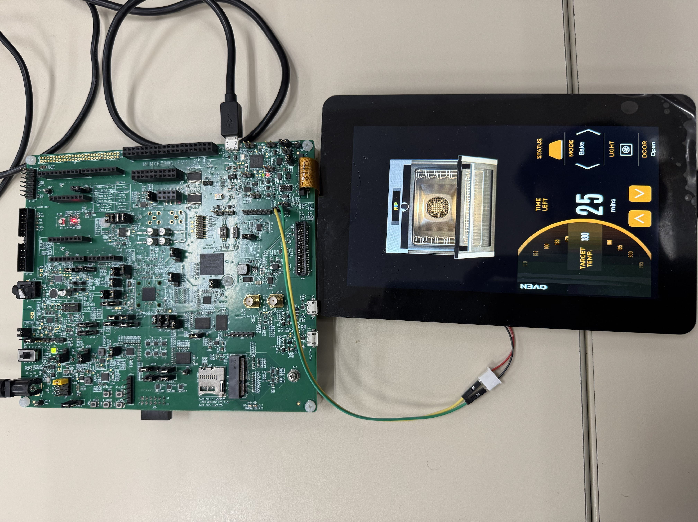

# NXP Application Code Hub
[](https://www.nxp.com)

## RT700 Oven Portrait: Smart Oven Graphical User Interface Demo

This application showcases the NXP **MIMXRT700-EVK** (i.MX RT700 crossover MCU, MIMXRT798S) running a portrait-oriented **Smart Oven control panel** built with **LVGL** and generated with **NXP GUI Guider**, on top of **FreeRTOS**. The UI is rendered on a MIPI-DSI capacitive touch display through the RT700 graphics pipeline (LCDIF display controller).<br />

The demo displays an interactive oven front panel: it shows the current **temperature** (165 by default) and **cooking time** (starts at 25 minutes), lets the user pick different **cooking modes** (fan-forced, upper/lower element, grill, defrost, etc.), and animates the **oven door** opening and closing along with **interior light** and **fan** states. All interaction is done through the capacitive touch screen. This project highlights the RT700's graphics acceleration and the LVGL + GUI Guider workflow for building rich embedded HMIs with NXP's development ecosystem.


#### Boards: FRDM-IMXRT700, MIMXRT700-EVK
#### Categories: HMI, Graphics, User Interface
#### Peripherals: MIPI-CSI, DISPLAY
#### Toolchains: VS Code

## Table of Contents
1. [Software](#step1)
2. [Hardware](#step2)
3. [Setup](#step3)
4. [Results](#step4)
5. [FAQs](#step5)
6. [Support](#step6)
7. [Release Notes](#step7)

## 1. Software<a name="step1"></a>
- [VS Code (1.107.0)](https://code.visualstudio.com/)
- [MCUXpresso for VS Code extension (25.11.16)](https://marketplace.visualstudio.com/items?itemName=NXPSemiconductors.mcuxpresso)
- [MCUXpresso SDK for RT700 (mcuxsdk-core)](https://github.com/nxp-mcuxpresso/mcuxsdk-core)
- Arm GNU Toolchain (armgcc), CMake 3.x, Ninja and west (installed with the MCUXpresso for VS Code toolset)
- Middleware / libraries used by the project:
  - **LVGL** (LittlevGL) graphics library, configured through Kconfig (`prj.conf`) and `lv_conf_ext.h`
  - **NXP GUI Guider** generated UI code (under `generated/`)

## 2. Hardware<a name="step2"></a>
- [MIMXRT700-EVK](https://www.nxp.com/design/design-center/development-boards-and-designs/i-mx-rt700-evaluation-kit:MIMXRT700-EVK) - i.MX RT700 crossover MCU (MIMXRT798S, Arm Cortex-M33, application runs on `cm33_core0`).
- FRDM-IMXRT700
- Waveshare Touch A display (1280x720) used in **portrait** orientation.
- Micro/USB-C cable (power, virtual COM port and on-board MCU-Link debug).
- External power supply
- Personal computer.


## 3. Setup<a name="step3"></a>

### 3.1 Prepare before import code
1. [Install VS Code.](https://www.nxp.com/design/design-center/training/TIP-GETTING-STARTED-WITH-MCUXPRESSO-FOR-VS-CODE)
2. [Install MCUXpresso for VS Code extension.](https://www.nxp.com/design/design-center/training/TIP-GETTING-STARTED-WITH-MCUXPRESSO-FOR-VS-CODE)
3. [Import the SDK repository (import can take about an hour).](https://www.nxp.com/design/design-center/training/TIP-GETTING-STARTED-WITH-MCUXPRESSO-FOR-VS-CODE)
    - Open the MCUXpresso for VS Code extension.
    - In the Quick Start Panel, click Import Repository.
    - Select the MCUXpresso SDK repository.
    - Select the main revision or a specific one if needed.
    - Select the save location.
    - Click import (this can take about an hour).

### 3.2 Import example from Application Code Hub
1. Open the MCUXpresso for VS Code extension.
2. In the Quick Start Panel, click Application Code Hub.
3. In the Search text field, type the name of this example.
4. Select the example, give it a name, and choose the directory where it will be saved.
5. Click Import Project and wait a few seconds. Select board **mimxrt700evk** and core
   **cm33_core0** if prompted.

### 3.3 Board connection
1. Attach the Waveshare display to connector **RPI**.
2. power on the waveshare display 5V-JP43(1), GND-JP43(2) for evk.
3. power on the waveshare display 5V-J23(8), GND-J23(7) for frdm.
4. Connect the board to the PC with a USB cable (power + virtual COM + MCU-Link debug).
5. Connect the power supply to J45
6. Open a serial terminal on the enumerated COM port:
   - 115200 baud rate, 8 data bits, no parity, one stop bit, no flow control.

### 3.4 Build and flash the application
1. Open the MCUXpresso extension in VS Code and select the project.
2. Check flash_config/flash_config.c to configure EVK or FRDM
3. Choose a build preset. Available presets (from `CMakePresets.json`): `debug`, `release`,
   `flash_debug`, `flash_release`. All target `board=mimxrt700evk`, `core_id=cm33_core0`,
   toolchain `armgcc`.
4. Do a pristine build and wait for it to finish.
5. Connect the board and click Run / Debug (play icon) to flash and start the demo.
6. Press reset or start the debugger. The oven UI appears on the display and startup log messages
   appear on the serial terminal.

Command-line alternative (west + CMake presets), with `SdkRootDirPath` pointing to your local
`mcuxsdk`:
```bash
cmake --preset debug
cmake --build --preset debug
```

## 4. Results<a name="step4"></a>
After flashing, the MIMXRT700-EVK/FRDM display shows the Smart Oven portrait control panel:
- Current temperature and cooking-time indicators.
- Selectable cooking modes (fan-forced, upper/lower element, grill, defrost, etc.).
- Animated oven door open/close plus light and fan states, driven by touch input.

[<p align="center"></p>](images/results.png)

## 5. FAQs<a name="step5"></a>

No FAQs at this time

## 6. Support<a name="step6"></a>

#### Project Metadata

<!----- Boards ----->
[]()
[]()

<!----- Categories ----->
[](https://mcuxpresso.nxp.com/appcodehub?category=hmi)
[](https://mcuxpresso.nxp.com/appcodehub?category=graphics)
[](https://mcuxpresso.nxp.com/appcodehub?category=ui)

<!----- Peripherals ----->
[](https://mcuxpresso.nxp.com/appcodehub?peripheral=mipi_csi)
[](https://mcuxpresso.nxp.com/appcodehub?peripheral=display)

<!----- Toolchains ----->
[](https://mcuxpresso.nxp.com/appcodehub?toolchain=vscode)

Questions regarding the content/correctness of this example can be entered as Issues within this GitHub repository.

>**Note**: For more general technical questions regarding NXP Microcontrollers and the difference in expected functionality, enter your questions on the [NXP Community Forum](https://community.nxp.com/)

[](https://www.youtube.com/NXP_Semiconductors)
[](https://www.linkedin.com/company/nxp-semiconductors)
[](https://www.facebook.com/nxpsemi/)
[](https://x.com/NXP)

## 7. Release Notes<a name="step7"></a>
| Version | Description / Update                           | Date                        |
|:-------:|------------------------------------------------|----------------------------:|
| 1.0     | Initial release on Application Code Hub        | September 29<sup>th</sup> 2026 |


<small>
<b>Trademarks and Service Marks</b>: There are a number of proprietary logos, service marks, trademarks, slogans and product designations ("Marks") found on this Site. By making the Marks available on this Site, NXP is not granting you a license to use them in any fashion. Access to this Site does not confer upon you any license to the Marks under any of NXP or any third party's intellectual property rights. While NXP encourages others to link to our URL, no NXP trademark or service mark may be used as a hyperlink without NXP’s prior written permission. The following Marks are the property of NXP. This list is not comprehensive; the absence of a Mark from the list does not constitute a waiver of intellectual property rights established by NXP in a Mark.
</small>
<br>
<small>
NXP, the NXP logo, NXP SECURE CONNECTIONS FOR A SMARTER WORLD, Airfast, Altivec, ByLink, CodeWarrior, ColdFire, ColdFire+, CoolFlux, CoolFlux DSP, DESFire, EdgeLock, EdgeScale, EdgeVerse, elQ, Embrace, Freescale, GreenChip, HITAG, ICODE and I-CODE, Immersiv3D, I2C-bus logo , JCOP, Kinetis, Layerscape, MagniV, Mantis, MCCI, MIFARE, MIFARE Classic, MIFARE FleX, MIFARE4Mobile, MIFARE Plus, MIFARE Ultralight, MiGLO, MOBILEGT, NTAG, PEG, Plus X, POR, PowerQUICC, Processor Expert, QorIQ, QorIQ Qonverge, RoadLink wordmark and logo, SafeAssure, SafeAssure logo , SmartLX, SmartMX, StarCore, Symphony, Tower, TriMedia, Trimension, UCODE, VortiQa, Vybrid are trademarks of NXP B.V. All other product or service names are the property of their respective owners. © 2021 NXP B.V.
</small>